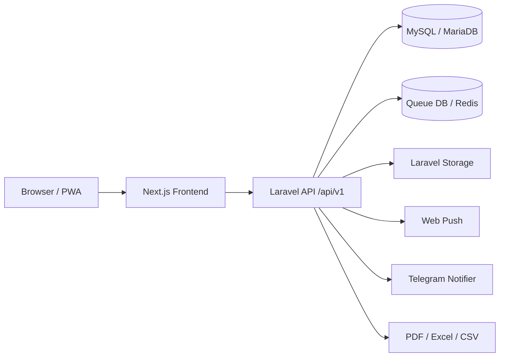

# System Architecture

## Gambaran

## Boundary

- Frontend bertanggung jawab untuk UI, state client, query cache, auth token localStorage, form validation, dan PWA behavior.
- Backend bertanggung jawab untuk authorization, validation final, business rules, persistence, notifications, export, audit, dan queue.
- Database menjadi sumber kebenaran untuk users, accounts, leads, survey, notifications, audit logs, imports, attendance, dan master data.

## Integrasi auth

1. Frontend memanggil `/api/v1/auth/login`.
2. Backend mengembalikan data user dan token/session sesuai implementasi `AuthController`.
3. Frontend menyimpan token di key `e_report_auth_token`.
4. Request API berikutnya memakai header `Authorization: Bearer <token>`.
5. Backend route memakai middleware `auth:sanctum`.

## Konvensi akses data frontend

- API client: `E-REPORT-FRONTEND/src/lib/api/client.ts`.
- Query keys: `E-REPORT-FRONTEND/src/lib/api/queryKeys.ts`.
- Hook domain: `E-REPORT-FRONTEND/src/lib/hooks/use*.ts`.
- Types shared client: `E-REPORT-FRONTEND/src/types/index.ts`.

## Konvensi akses data backend

- Route API: `E-REPORT-BACKEND_API/routes/api.php`.
- Controller API: `E-REPORT-BACKEND_API/app/Http/Controllers/Api`.
- Validasi request: `E-REPORT-BACKEND_API/app/Http/Requests`.
- Model dan relationship: `E-REPORT-BACKEND_API/app/Models`.
- Business service: `E-REPORT-BACKEND_API/app/Services`.

