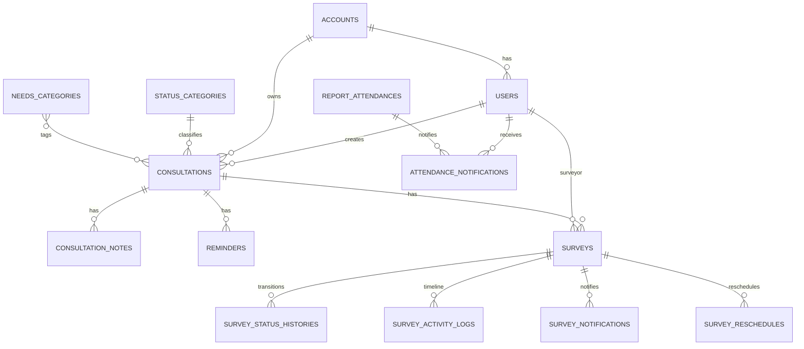

# Data Model

## Entity utama

## Tabel inti dari migrations

- `accounts`: cabang/akun, logo, account group.
- `users`: user role admin/super admin/surveyor/manager surveyor, primary color, last seen.
- `needs_categories`: kategori kebutuhan/produk.
- `status_categories`: status pipeline lead, warna/CSS, sort order.
- `consultations`: data lead, termasuk nomor utama dan nomor telepon darurat opsional.
- `consultation_needs_category`: pivot multi kategori kebutuhan.
- `consultation_notes`: timeline follow-up.
- `reminders`: reminder per lead.
- `report_attendances`: laporan harian admin.
- `attendance_notifications`: notifikasi absensi admin untuk super admin.
- `audit_logs`: perubahan penting.
- `consultation_imports`: tracking import massal.
- `consultation_sequences`: counter ID lead per akun per bulan.
- `push_subscriptions`: web push endpoint.
- `bug_reports`: laporan bug dari user/login.
- `survey_statuses`: master status hasil survey.
- `surveys`: request dan jadwal survey.
- `survey_status_histories`: histori transition state.
- `survey_activity_logs`: timeline aktivitas survey.
- `survey_notifications`: notifikasi survey.
- `survey_reschedules`: histori reschedule.

## Index/performance

- Ada migrations khusus search indexes, performance indexes, date indexes, compound indexes.
- Consultation query harus menjaga filter `account_id`, status, tanggal, dan search agar tetap memakai indeks.
- Dashboard dan analytics memakai cache dan invalidasi pada perubahan status/data terkait.

## Detail lanjutan

- [[15-Backend-Internals/Models-and-Relationships]]
- [[15-Backend-Internals/Migrations-and-Indexes]]
- [[11-Modules/Consultations]]
- [[11-Modules/Survey]]
