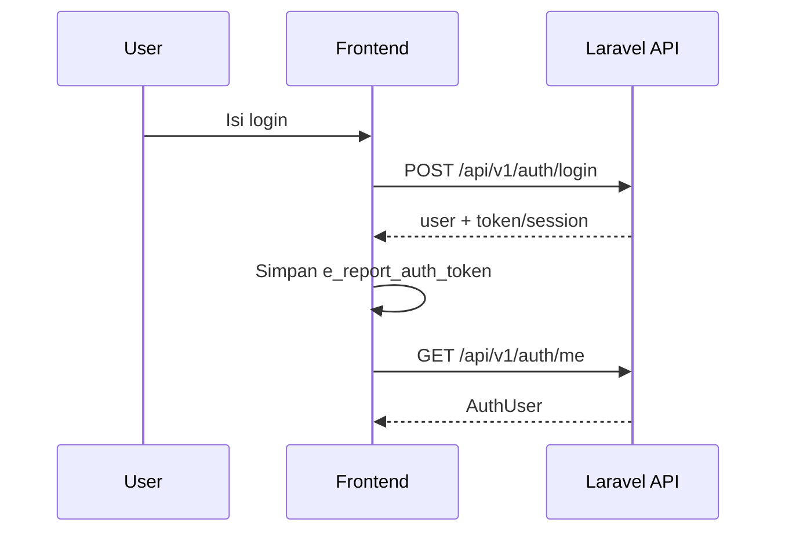
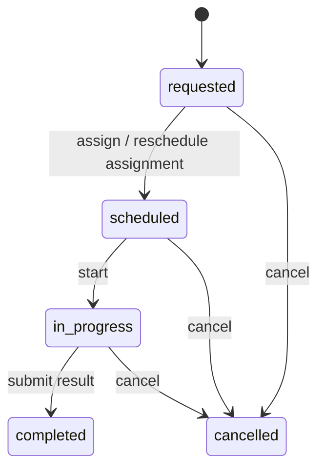

# Core Workflows

## Login

## Lead/konsultasi

1. Admin membuat lead lewat `/consultations/create` atau import.
2. Backend validasi lewat `ConsultationRequest`.
3. Backend generate `consultation_id` format `AA.YYMM.NNNN`.
4. Lead punya account, status, kebutuhan, lokasi, detail produk, catatan, reminders.
5. Status dapat diubah manual atau tersinkron oleh workflow survey.

## Import lead

1. User download template.
2. User upload file import.
3. Backend mencatat `consultation_imports`.
4. Job `ProcessConsultationImportJob` memproses data via queue.
5. Duplicate detection memakai nomor telepon ternormalisasi atau profile key.

## Survey

Catatan:

- Transition ditulis ke `survey_status_histories` dan `survey_activity_logs`.
- State `in_progress` dapat menyetel status lead ke `Sedang Survey`.
- State `completed` dapat menyetel status lead ke `Selesai Survey`.
- Cancel dari status survey tertentu dapat mengembalikan lead ke `Request Survey`.

## Notifications

- Notes, reminders, dan survey notifications muncul lewat `/notifications/summary`.
- Web push memakai `PushSubscriptionController` dan `WebPushService`.
- Reminder due dapat diproses lewat command `PushDueReminders`.

## Detail modul

- [[11-Modules/Auth-and-Users]]
- [[11-Modules/Consultations]]
- [[11-Modules/Survey]]
- [[11-Modules/Notifications]]
- [[11-Modules/Reporting-and-Analytics]]
